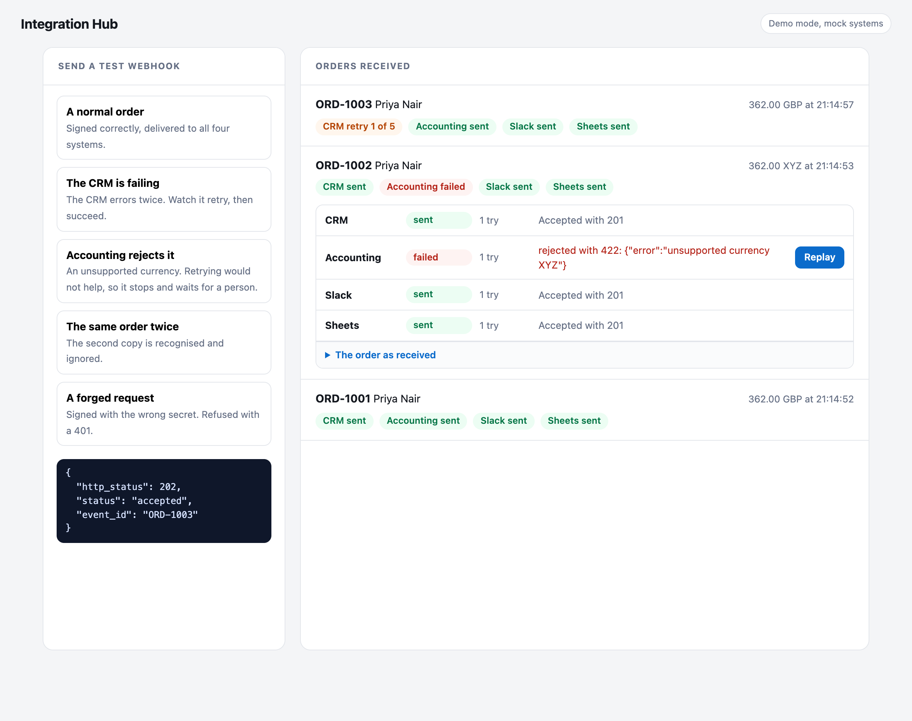

# Integration Hub

A small service that connects a shop to the other systems a business runs on. The shop sends a signed webhook when an order is placed. The hub checks it is genuine, rejects bad or repeated ones, and delivers the order to a CRM, an accounting system, Slack and a spreadsheet, each in the format that system expects. When a system is down it retries. When a system refuses an order it stops, says why, and waits for a person to replay it.

This project uses no AI. It is plain integration engineering: the part that makes automations reliable. The four systems in the demo are stand ins that run inside the app, so nothing here needs an account.

## What it looks like

An order mid retry (the CRM has failed once and will try again), an order where accounting refused an unsupported currency, and an order that went through cleanly:



The buttons on the left send signed test webhooks so each case can be seen without writing a second program.

## What happens to a webhook

1. **Check it is genuine.** The request carries `X-Timestamp` and `X-Signature`, an HMAC SHA 256 of the timestamp and body with a shared secret. A wrong signature, a changed body or a missing header gets a 401. A request older than 5 minutes also gets a 401, so a captured request cannot be replayed later. The comparison is constant time.
2. **Check the order makes sense.** The body must be valid JSON in the expected shape, and the total must add up to the items. Anything else gets a 400 or a 422 that names the problem, and nothing is stored.
3. **Ignore repeats.** Senders retry too. An order id seen before gets a 200 `duplicate` and is not delivered again.
4. **Store, then answer.** The event and one pending delivery per system are saved together or not at all, and the sender gets a 202 straight away. Delivery happens after, so a slow system never makes the sender wait.
5. **Deliver each system on its own.** A worker sends each delivery with its own payload. One system failing does not hold up the others.

## How failures are treated

| What the destination does | What the hub does |
|---|---|
| Answers 2xx | Done |
| Network error, 408, 429 or 5xx | Retry after 2, 4, 8 and 16 seconds, then give up and mark it failed. A `Retry-After` header is respected, up to an hour |
| Any other 4xx, such as a 422 | Stop at once and show the reason. Retrying a refusal only repeats it |
| Redirect | Stop. The hub does not follow redirects |

Every request carries an `Idempotency-Key` of the event id and the system name, so a retry after a lost reply cannot create a second record in a system that honours it. A failed delivery can be replayed from the page once the cause is fixed. It then gets a fresh set of attempts.

## Run it

Built and tested with Python 3.13 and FastAPI 0.142.

```bash
python3 -m venv .venv
source .venv/bin/activate
pip install -r requirements-dev.txt
python -m pytest                                  # 81 tests
python -m uvicorn app.main:create_app --factory   # then open http://127.0.0.1:8000
```

Settings, all optional:

| Variable | Default | Meaning |
|---|---|---|
| `WEBHOOK_SECRET` | `demo-secret-change-me` | The shared secret. Change it |
| `HUB_DB` | `data/hub.db` | SQLite file |
| `MAX_ATTEMPTS` | 5 | Tries before a delivery is marked failed |
| `BASE_DELAY` | 2 | Seconds before the first retry, doubling each time |
| `SIGNATURE_TOLERANCE` | 300 | How old a signed request may be, in seconds |
| `DESTINATION_URLS` | none | JSON such as `{"crm": "https://...", "slack": "https://..."}`. Setting it switches the demo mode off and sends to those URLs |
| `DEMO_MODE` | 1 | Set to 0 to remove the demo buttons and the built in mock systems |

## Sending it a webhook

```python
import hashlib, hmac, json, time, httpx

secret = "demo-secret-change-me"
body = json.dumps({
    "id": "ORD-5001", "type": "order.created",
    "customer": {"name": "Priya Nair", "email": "priya@example.com"},
    "items": [{"sku": "DESK-120", "name": "Standing desk", "qty": 1, "unit_price": 349.0}],
    "currency": "GBP", "total": 349.0,
}).encode()
ts = str(int(time.time()))
sig = "sha256=" + hmac.new(secret.encode(), f"{ts}.".encode() + body, hashlib.sha256).hexdigest()
print(httpx.post("http://127.0.0.1:8000/webhooks/orders", content=body,
                 headers={"X-Timestamp": ts, "X-Signature": sig}).json())
```

## API

| Request | What it does |
|---|---|
| `POST /webhooks/orders` | The webhook. 202 accepted, 200 duplicate, 400, 401, 413 or 422 |
| `GET /api/events` | The latest 50 orders with the state of each delivery |
| `GET /api/events/{id}` | One order |
| `POST /api/deliveries/{id}/replay` | Replay a failed delivery |
| `POST /api/run` | Try everything that is due now, without waiting for the worker |
| `POST /api/demo/send` | Demo mode only. Sends a signed test order for a named scenario |
| `GET /api/health` | Mode and configured systems |

## Honest limitations

- **The four systems are stand ins.** Real CRMs, accounting tools, Slack and Google Sheets each have their own authentication, field names and rules. The mapping in `app/mapping.py` is written for made up shapes and the destination settings take only a URL, so a real project means adapting both for each system.
- **The signature format is one common pattern**, an HMAC over the timestamp and body. Stripe, Shopify and others each use their own variation, so `app/signing.py` needs adapting to the sender you connect.
- **One process only.** The queue is SQLite and a single worker thread, with a lock inside the process. Running several copies could send a delivery twice. Scaling out needs rows claimed in the database (for example `FOR UPDATE SKIP LOCKED` in Postgres) or a real queue.
- **Delivery is at least once.** If the server stops after a system accepts an order but before that is recorded, the order is sent again on restart. The `Idempotency-Key` header lets a system ignore the repeat, but only if it supports that.
- **The dashboard and API have no login.** Anyone who can reach the server can read orders and replay deliveries. Add authentication before real use, and keep `/webhooks/orders` open only to the signature check.
- **Demo mode signs requests with the real secret** so the buttons work. Turn it off outside a demo.
- **One kind of event.** Only `order.created`. Other events mean new models and mappings.
- **No clean up.** Events are kept forever and the page shows the latest 50.

## Project layout

```
app/main.py              the webhook endpoint, the API and the page
app/signing.py           signature check
app/events.py            the order shape and its checks
app/mapping.py           one order into each system's format
app/store.py             SQLite storage of events and deliveries
app/deliver.py           sending, retrying, giving up
app/mock_destinations.py the stand in systems
static/index.html        the page
tests/                   pytest suite
```
